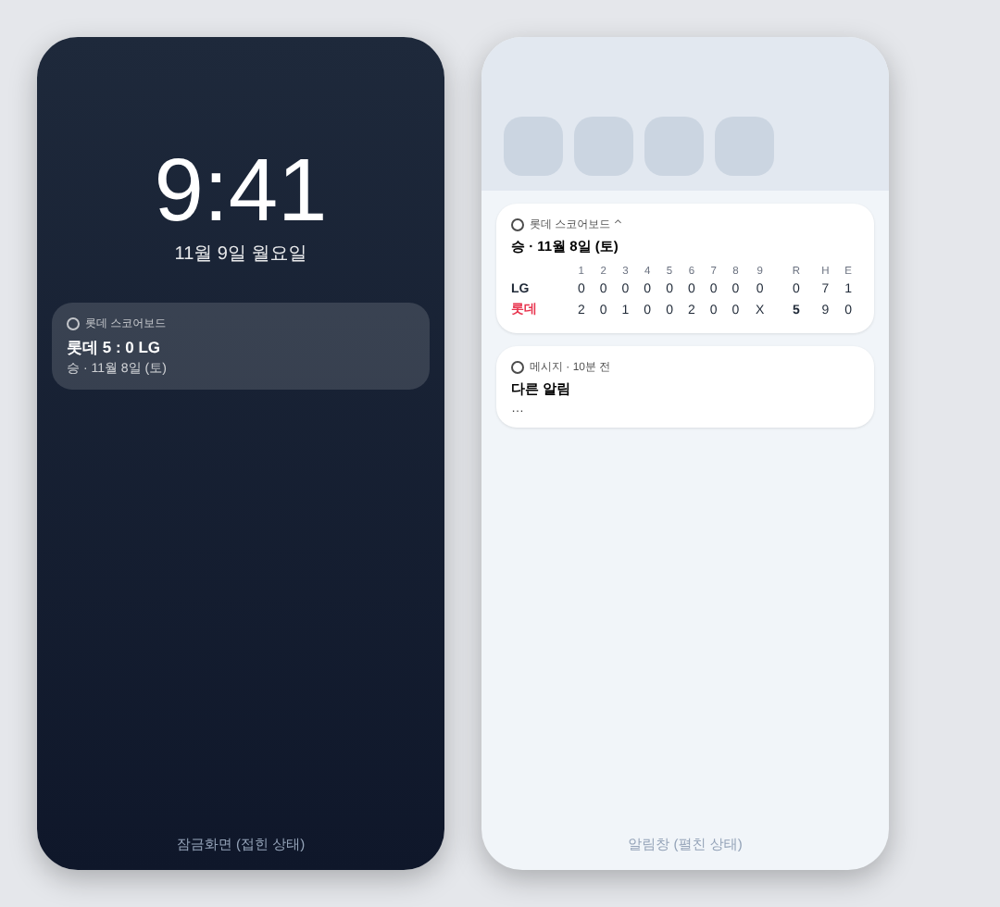
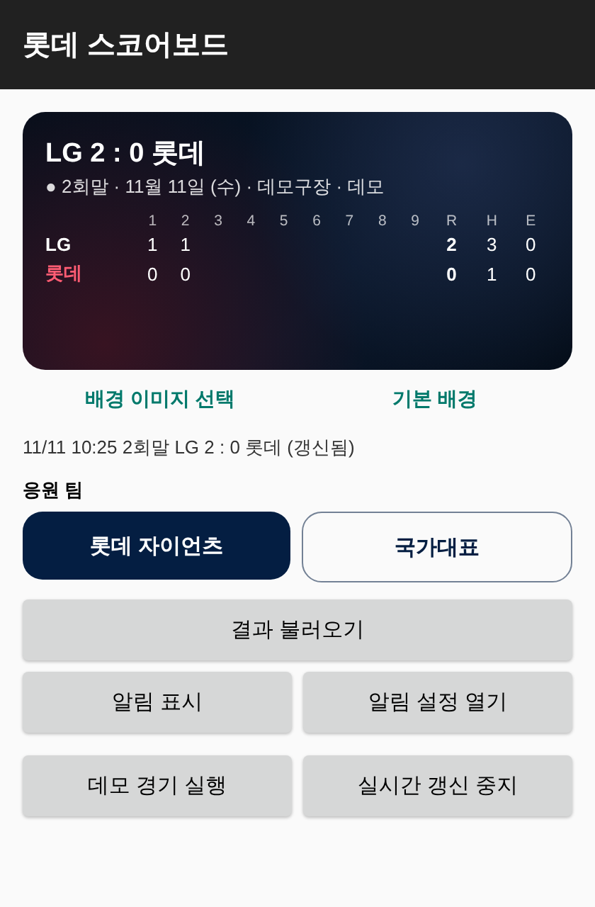

# 롯데 스코어보드

롯데 자이언츠의 최근 경기 **최종 스코어**와 **진행 중인 경기 점수**를 알림으로 계속 띄워 두는 안드로이드 앱입니다. 잠금화면과 알림창에서 언제든 확인할 수 있습니다.

> **⚠️ 안내**
> - 개인 학습·취미용 비공식 프로젝트입니다. **롯데 자이언츠, KBO, 네이버와 관련이 없으며** 이들의 승인이나 후원을 받지 않았습니다.
> - 경기 데이터는 **네이버 스포츠의 비공개(비공식) API**에서 가져옵니다. 이 API는 공개된 적이 없어서 예고 없이 바뀌거나 막힐 수 있습니다.
> - 데이터에 대한 권리는 각 제공처에 있습니다. **상업적으로 쓰거나 많은 사람에게 배포하지 마세요.** 네이버 이용약관을 직접 확인하고 각자 책임하에 사용하세요.
> - 팀 이름 등 상표는 각 소유자의 것입니다. 이 저장소에는 구단 로고나 공식 이미지가 들어 있지 않습니다.

| 알림 | 앱 화면 |
|---|---|
|  |  |

(두 그림 모두 디자인 시안입니다. 실제 모양은 기기와 안드로이드 버전에 따라 조금 다릅니다. 앱 화면의 배경은 예시로 그린 그라데이션입니다.)

## 알림 구성
- **접힌 상태**(잠금화면에서 주로 보이는 부분)
  - 종료 후: `LG 0 : 5 롯데` / `승 · 11월 8일 (토)`
  - 경기 중: `LG 2 : 3 롯데` / `● 7회말 · 11월 9일 (일)`
- 점수는 야구 표기 관례대로 **원정 : 홈** 순서입니다. 점수표도 원정이 위, 홈이 아래입니다.
- **펼친 상태**: 이닝별 라인스코어(1~9회, 연장, R H E). 롯데는 빨간색으로 표시합니다.
- 소리·진동·팝업이 없는 상시 알림입니다.
  - 채널 중요도를 '기본'으로 둬서 아래쪽 '무음 알림' 구역이 아니라 일반 알림 구역에 표시됩니다.
  - 같은 구역 안의 순서는 안드로이드가 정하기 때문에, 더 최근에 온 알림이 위로 올라갈 수 있습니다.
  - Android 14부터는 밀어서 지울 수 있고, 지우면 다음 새 결과가 나올 때 다시 뜹니다.

## 앱 화면 배경
- 앱 화면 위쪽 스코어보드 카드 뒤에 원하는 사진을 깔 수 있습니다.
  - **배경 이미지 선택**: 시스템 사진 선택기에서 고릅니다. 저장소 권한은 필요 없습니다.
  - **기본 배경**: 사진을 지우고 기본 회색 카드로 되돌립니다.
- 고른 사진은 화면 폭에 맞게 줄여서 앱 내부에 복사해 둡니다. 원본을 지워도 유지됩니다.
- 사진 위에는 반투명 검은색을 덮고 글자를 흰색으로 바꿔서 점수가 잘 보이게 합니다.
- 알림은 기본 흰 배경(다크 모드에서는 검은 배경) 그대로입니다.

## 데이터: 네이버 스포츠 (API 키 필요 없음)
- 경기 목록: `GET https://api-gw.sports.naver.com/schedule/games?upperCategoryId=kbaseball&categoryId=kbo&fromDate=..&toDate=..&teamCode=LT`
- 경기 기록(이닝별 점수, R H E, 구장): `GET https://api-gw.sports.naver.com/schedule/games/{gameId}/record`
- **비공식 API**라서 네이버가 형식을 바꾸면 수정이 필요할 수 있습니다.
- 팀 필터나 개수 옵션이 안 먹혀서 일부만 오면, 하루씩 나눠서 다시 받습니다.
- 3시간마다 최근 2주 경기만 확인해서 새 결과가 있으면 알림을 갱신합니다.
- 앱에서 직접 불러올 때(또는 팀을 바꿀 때)는, 최근 2주에 경기가 없으면 2주씩 거슬러 올라가며 마지막 경기를 찾습니다(비시즌 대비).

## 실시간 갱신 (경기 중)
- 3시간 주기 작업이 오늘 경기를 발견하면 **경기 시작 시각에 정확한 알람**을 예약합니다.
- 알람이 울리면 실시간 서비스가 시작되고, 스코어보드 알림이 그대로 실시간 점수판이 됩니다.
  - 화면이 켜져 있으면 5분마다, 꺼져 있으면 15분마다 점수를 확인합니다.
  - **화면을 켜는 순간** 바로 확인합니다(직전 확인 후 3분 이내면 생략).
  - 점수가 바뀌었을 때만 알림을 고칩니다.
- 경기가 끝나면 최종 스코어 알림을 남기고 서비스가 스스로 종료합니다. 추가 API 호출은 없습니다.
- 진행 이닝(`7회말`)은 네이버가 주는 값을 그대로 씁니다.
- 과도한 요청을 막기 위해 하루 요청이 400회를 넘으면 실시간 갱신을 멈춥니다(보통 경기 하나에 100회 안팎).

## 빌드 / 설치
1. Android Studio로 이 폴더를 열고 기기에서 실행합니다(minSdk 28 / Android 9+).
2. 앱의 **응원 팀** 토글에서 **롯데 자이언츠** 또는 **국가대표**를 고르면 바로 결과를 불러옵니다. 기본값은 롯데입니다.
3. **알림 표시**를 누르고 알림 권한을 허용합니다.

- 롯데 자이언츠: 네이버 팀 코드 `LT`, 리그 `kbo`
- 국가대표: 팀 코드 `KR`, 리그는 지정하지 않음(야구 전체). APBC·WBC처럼 대회마다 분류가 달라도 한국 경기를 찾습니다.
- 다른 팀을 추가하려면 `Prefs.kt`의 `TeamChoice`에 항목을 넣고 토글 버튼을 하나 더 만들면 됩니다.

### 잠금화면에 점수가 안 보이면
- **설정 → 잠금화면 → 알림**에서 표시 방식을 "아이콘만"이 아니라 **내용/세부 정보 표시**로 바꿉니다(삼성 기준).
- **알림 설정 열기** 버튼에서 '경기 스코어보드' 채널이 켜져 있고 잠금화면 표시가 허용돼 있는지 확인합니다.

## 테스트
- **데모 경기 실행**: API 없이 가상 경기가 20초마다 반 이닝씩 진행됩니다. 끝나면 1분 동안 최종 스코어를 보여준 뒤 실제 최근 경기로 돌아갑니다.
- **APBC 한국 대표팀 (2026.11.12~15, 도쿄돔)**: 토글에서 **국가대표**를 고릅니다.
  - 경기 당일에 고르거나 **결과 불러오기**를 누르면 경기 시작 시각에 실시간 갱신이 예약됩니다.
  - 12일 12:00 호주전, 13일 19:00 일본전, 14일 19:00 대만전
  - 끝나면 **롯데 자이언츠**로 되돌립니다.

## 파일 구성
| 파일 | 역할 |
|---|---|
| `ScoreParser.kt` | 네이버 응답 파싱, 추적 팀의 종료/진행 중 경기 찾기 (실제 응답으로 유닛 테스트) |
| `NaverSportsClient.kt` | 네이버 스포츠 경기 목록·기록 요청 |
| `ScoreUpdater.kt` | 결과 갱신·캐시, 오늘 경기 감지 → 실시간 갱신 예약 |
| `ScoreNotifier.kt` | 스코어보드 알림 (접힌 요약 + 펼친 라인스코어) |
| `res/layout/notification_scoreboard.xml` | 펼친 알림의 라인스코어 레이아웃 |
| `UpdateWorker.kt` | 3시간 주기 자동 갱신 |
| `LiveController.kt` | 정확한 알람 예약, 실시간 서비스 시작/중지 |
| `LiveScoreService.kt` | 경기 중 실시간 갱신 (포그라운드 서비스) |
| `DemoGame.kt` | 테스트용 가상 경기 |
| `MainActivity.kt` | 설정 화면 (알림과 같은 레이아웃으로 미리보기) |

## 주의
- `USE_EXACT_ALARM` 권한은 Play 스토어에 올릴 경우 심사 대상입니다. 개인 설치용으로는 문제 없습니다.
- 네이버 스포츠 데이터는 개인용으로만 쓰세요. 앱을 배포하면 이용약관 문제가 생길 수 있습니다.

## 라이선스
- 이 저장소의 **소스 코드**는 [MIT 라이선스](LICENSE)입니다.
- 앱이 받아오는 **경기 데이터**와 팀 이름 등 **상표**는 MIT 라이선스 대상이 아니며, 각 권리자에게 있습니다.

