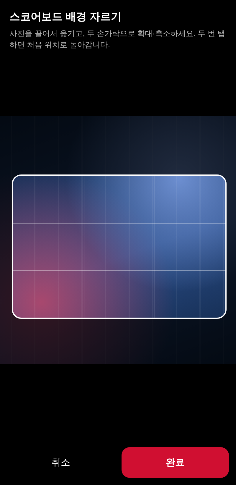

# 롯데 스코어보드

응원 팀(롯데 자이언츠 또는 국가대표)의 **경기 스코어보드**를 보여주는 개인용 안드로이드 앱입니다.

- 앱 화면에서는 **야구장 전광판 스타일**로 최근 경기·오늘 경기·진행 중인 경기를 보여줍니다.
- 같은 스코어보드를 **알림으로 계속 띄워 둬서** 잠금화면과 알림창에서도 바로 확인할 수 있습니다.
- 경기 중에는 점수를 **실시간으로 갱신**합니다.

> **⚠️ 안내**
> - 개인 학습·취미용 비공식 프로젝트입니다. **롯데 자이언츠, KBO, 네이버와 관련이 없으며** 이들의 승인이나 후원을 받지 않았습니다.
> - 경기 데이터는 **네이버 스포츠의 비공개(비공식) API**에서 가져옵니다. 이 API는 공개된 적이 없어서 예고 없이 바뀌거나 막힐 수 있습니다.
> - 데이터에 대한 권리는 각 제공처에 있습니다. **상업적으로 쓰거나 많은 사람에게 배포하지 마세요.** 네이버 이용약관을 직접 확인하고 각자 책임하에 사용하세요.
> - 팀 이름 등 상표는 각 소유자의 것입니다. 구단 로고나 공식 이미지는 들어 있지 않습니다.
> - 전광판 제목에 쓰는 **Giants Inline 폰트는 무료로 쓸 수 있지만 상업적 사용은 제한**됩니다. 이 앱을 상업적으로 쓰려면 이 폰트를 빼야 합니다. 자세한 내용은 [라이선스](#라이선스)를 참고하세요.

| 앱 화면 | 알림 (잠금화면 / 알림창) |
|---|---|
|  |  |

(디자인 시안입니다. 실제 모양은 기기와 안드로이드 버전에 따라 조금 다릅니다.)

## 주요 기능
- **전광판 스코어보드**: 이닝별 점수(1~9회, 연장), R·H·E, 경기 전 / 경기 중 / 경기 종료 상태
- **응원 팀 선택**: 롯데 자이언츠 / 국가대표(APBC·WBC 등 국제대회)
- **알림 스코어보드**: 잠금화면·알림창에 상시 표시, 소리·진동 없음
- **실시간 갱신**: 경기 시작 시각에 자동으로 시작, 경기 중 5분 간격, 화면을 켜면 바로 확인
- **배경 사진**: 전광판 뒤에 원하는 사진을 3:2로 잘라서 넣기
- **API 키 필요 없음**: 네이버 스포츠에서 바로 받아옴

## 앱 화면
위에서부터 다음 순서로 나옵니다.

1. **제목 + 응원 팀 선택**: 오른쪽 버튼을 누르면 **롯데 자이언츠 / 국가대표** 중에서 고르는 메뉴가 뜹니다. 팀을 바꾸면 바로 그 팀의 결과를 불러옵니다.
2. **전광판** (가로:세로 3:2 고정)
   - 제목: 롯데는 **GIANTS**(남색 글자 + 하늘색 테두리), 국가대표는 **태극 마크 + TEAM KOREA**(위 빨강·아래 파랑)
   - 오른쪽 위 상태: **경기 전**(주황) / **경기 중**(초록) / **경기 종료**(회색)
   - 날짜 · 구장 · (국제대회면 대회 이름, 예: APBC)
   - 라인스코어: 검은 칸에 주황 전광판 숫자. 원정팀이 위, 홈팀이 아래. 응원 팀은 빨간색
   - 아래 띠
     - 경기 종료: `롯데 승` · `7 - 4` · `10:29 갱신`
     - 경기 중: `● 7회말` · 점수 · 갱신 시각
     - 경기 전: `실시간 갱신 예약됨` · `PLAY BALL 12:00`
   - **오늘 경기가 예정돼 있으면** 지난 경기 대신 오늘 경기를 '경기 전'으로 보여줍니다.
3. **결과 불러오기**: 지금 바로 최신 결과를 받아옵니다.
4. **설정 목록**
   - **알림에 스코어보드 표시** (스위치): 끄면 알림을 지우고, 경기 중 실시간 갱신도 하지 않습니다. 앱 화면은 계속 갱신됩니다.
   - **스코어보드 배경**: 사진 선택 / 기본 배경으로 ([전광판 배경 사진](#전광판-배경-사진))
   - **휴대폰 알림 설정**: 이 앱의 안드로이드 알림 설정 화면을 엽니다.
5. **실시간 갱신 중지** (맨 아래)

### 전광판 배경 사진


- **스코어보드 배경 → 사진 선택**을 누르면 시스템 사진 선택기가 열리고, 사진을 고르면 **자르기 화면**으로 넘어갑니다. 저장소 권한은 필요 없습니다.
- 3:2 틀은 고정돼 있고, 사진을 **끌어서 옮기고 두 손가락으로 확대·축소**해서 맞춥니다.
  - 두 번 탭하면 처음 위치로 돌아갑니다.
  - 사진이 틀 밖으로 비지 않게 자동으로 맞춰지고, 최대 8배까지 확대됩니다.
- **완료**를 누르면 틀 안 부분만 잘라(최대 폭 1440px) 앱 안에 저장합니다. 갤러리에서 원본을 지워도 유지됩니다.
- 사진 위에는 전광판 색을 반투명하게 덮어서 숫자가 잘 보이게 합니다.
- **기본 배경으로**를 고르면 사진을 지우고 기본 전광판으로 돌아갑니다.

## 알림
- **접힌 상태**(잠금화면에서 주로 보이는 부분)
  - 경기 종료: `롯데 7 : 4 두산` / `승 · 10월 12일 (월) · 잠실`
  - 경기 중: `LG 2 : 3 롯데` / `● 7회말 · …`
  - 점수는 야구 표기 관례대로 **원정 : 홈** 순서입니다.
- **펼친 상태**: 이닝별 라인스코어(1~9회, 연장, R·H·E). 응원 팀은 빨간색입니다.
- 알림은 안드로이드 기본 모양(흰 배경, 다크 모드에서는 검은 배경)입니다.
- 소리·진동·팝업이 없는 상시 알림입니다.
  - 채널 중요도를 '기본'으로 둬서 아래쪽 '무음 알림' 구역이 아니라 일반 알림 구역에 표시됩니다.
  - 같은 구역 안의 순서는 안드로이드가 정하기 때문에, 더 최근에 온 알림이 위로 올라갈 수 있습니다.
  - Android 14부터는 밀어서 지울 수 있고, 지우면 다음 새 결과가 나올 때 다시 뜹니다.
- 알림에는 예정 경기를 띄우지 않습니다. 경기 전에는 직전 경기 결과를 계속 보여줍니다.

## 실시간 갱신 (경기 중)
- **3시간마다** 최근 2주 경기를 확인해서 새 결과가 있으면 알림을 갱신합니다.
- 이때 오늘 경기를 발견하면 **경기 시작 시각에 정확한 알람**을 예약합니다.
- 알람이 울리면 실시간 서비스가 시작되고, 스코어보드 알림이 그대로 실시간 점수판이 됩니다.
  - 화면이 켜져 있으면 **5분마다**, 꺼져 있으면 15분마다 점수를 확인합니다.
  - **화면을 켜는 순간** 바로 확인합니다(직전 확인 후 3분 이내면 생략).
  - 점수가 바뀌었을 때만 알림을 고칩니다.
- 경기가 끝나면 최종 스코어 알림을 남기고 서비스가 스스로 멈춥니다.
- 우천 지연 등으로 시작이 늦어지면 예정 시각 3시간 뒤까지 기다립니다. 취소·서스펜디드 경기는 바로 멈춥니다.
- 하루 요청이 400회를 넘으면 실시간 갱신을 멈춥니다(보통 경기 하나에 100회 안팎).
- **알림에 스코어보드 표시**를 끄면 실시간 갱신도 하지 않습니다.

## 데이터: 네이버 스포츠 (비공식 API, 키 필요 없음)
- 경기 목록: `GET https://api-gw.sports.naver.com/schedule/games?upperCategoryId=kbaseball&categoryId=kbo&fromDate=..&toDate=..&teamCode=LT`
- 경기 기록(이닝별 점수, R·H·E, 구장): `GET https://api-gw.sports.naver.com/schedule/games/{gameId}/record`
- 팀 설정
  - 롯데 자이언츠: 팀 코드 `LT`, 리그 `kbo`
  - 국가대표: 팀 코드 `KR`, 리그는 지정하지 않음(야구 전체). APBC·WBC처럼 대회마다 분류가 달라도 한국 경기를 찾습니다.
- 팀 필터나 개수 옵션이 안 먹혀서 일부만 오면, 하루씩 나눠서 다시 받습니다.
- 앱에서 직접 불러올 때(또는 팀을 바꿀 때)는, 최근 2주에 경기가 없으면 2주씩 거슬러 올라가며 마지막 경기를 찾습니다(비시즌 대비).
- 요청에는 앱 이름(`LotteScoreboard`)을 밝혀서 보내고, 네이버 계정이나 로그인은 쓰지 않습니다.

## 설치
### 준비
- Android Studio (최신 버전), Git
- 안드로이드 9 이상 폰 (minSdk 28)

### 처음 설치
1. Android Studio에서 **File → New → Project from Version Control**을 고르고 이 저장소를 받습니다(Clone).
   - 저장 위치는 **한글이 없는 경로**로 하세요(예: `C:\dev\giants`). 경로에 한글이 있으면 빌드가 실패할 수 있습니다.
2. Gradle sync가 끝날 때까지 기다립니다.
3. 폰에서 **개발자 옵션 → USB 디버깅**(또는 **무선 디버깅**)을 켭니다.
   - 갤럭시는 **보안 위험 자동 차단**을 잠시 꺼야 설치됩니다.
4. 상단 기기 목록에서 폰을 고르고 **▶ Run**을 누릅니다.
5. 설치가 끝나면 보안 위험 자동 차단을 다시 켜도 됩니다. 앱은 계속 동작합니다.

### 업데이트
1. Android Studio에서 **Git → Pull** (`Ctrl+T`)
2. 폰을 연결하고 **▶ Run**. 같은 PC에서 빌드하면 기존 앱 위에 설치되고 설정도 유지됩니다.

### 처음 실행할 때
1. **결과 불러오기**를 누릅니다(기본 팀은 롯데).
2. **알림에 스코어보드 표시**를 켜고 알림 권한을 허용합니다.

### 잠금화면에 점수가 안 보이면
- 휴대폰 **설정 → 잠금화면 → 알림**에서 표시 방식을 "아이콘만"이 아니라 **내용/세부 정보 표시**로 바꿉니다(삼성 기준).
- 앱의 **휴대폰 알림 설정**에서 '경기 스코어보드' 채널이 켜져 있고 잠금화면 표시가 허용돼 있는지 확인합니다.

## 테스트
- **유닛 테스트**: `app/src/test/`. 실제 네이버 응답(2026년 9월 롯데 경기, APBC 일정)으로 파싱을 확인하고, 자르기 계산도 확인합니다.
  ```bash
  ./gradlew test
  ```
- **데모 경기**: 화면에는 버튼이 없고, 제목 **"스코어보드"를 길게 누르면** 실행됩니다. 가상 경기가 20초마다 반 이닝씩 진행돼서 알림과 전광판이 바뀌는 걸 확인할 수 있습니다. 끝나면 1분 동안 최종 스코어를 보여준 뒤 실제 최근 경기로 돌아갑니다.

## 프로젝트 구조
| 파일 | 역할 |
|---|---|
| `MainActivity.kt` | 메인 화면 (팀 선택, 결과 불러오기, 설정 목록) |
| `ScoreboardBinder.kt` | 앱 화면 전광판 그리기 (제목, 상태, 라인스코어, 아래 띠) |
| `AspectRatioFrameLayout.kt` | 3:2 비율로 고정되는 전광판 카드 |
| `CropActivity.kt`, `CropImageView.kt` | 배경 사진 자르기 화면 (3:2 틀, 이동·확대) |
| `CropMath.kt` | 자르기 계산 (확대 한도, 빈틈 방지, 잘라낼 영역) |
| `ScoreParser.kt` | 네이버 응답 파싱, 응원 팀의 종료·진행 중·예정 경기 찾기 |
| `NaverSportsClient.kt` | 네이버 스포츠 경기 목록·기록 요청 |
| `ScoreUpdater.kt` | 결과 갱신·저장, 오늘 경기 감지 → 실시간 갱신 예약 |
| `ScoreNotifier.kt` | 스코어보드 알림 (접힌 요약 + 펼친 라인스코어) |
| `UpdateWorker.kt` | 3시간 주기 자동 갱신 |
| `LiveController.kt` | 정확한 알람 예약, 실시간 서비스 시작·중지 |
| `LiveScoreService.kt` | 경기 중 실시간 갱신 (포그라운드 서비스) |
| `Prefs.kt` | 설정·저장값 (응원 팀, 알림 스위치, 저장된 경기) |
| `DemoGame.kt` | 테스트용 가상 경기 |
| `res/layout/activity_main.xml` | 메인 화면 레이아웃 |
| `res/layout/notification_scoreboard.xml` | 펼친 알림의 라인스코어 |
| `res/font/` | `giants_inline.otf`(전광판 제목), `vt323.ttf`(전광판 숫자) |

## 주의
- `USE_EXACT_ALARM` 권한과 백그라운드 실시간 갱신은 Play 스토어에 올릴 경우 심사 대상입니다. 개인 설치용으로는 문제 없습니다.
- 네이버 스포츠 데이터와 Giants Inline 폰트 때문에 **상업적 사용이나 배포는 하지 마세요.**

## 라이선스
- 이 저장소의 **소스 코드**는 [MIT 라이선스](LICENSE)입니다.
- **VT323 폰트**(`res/font/vt323.ttf`): SIL Open Font License 1.1 ([licenses/VT323-OFL.txt](licenses/VT323-OFL.txt))
- **Giants Inline 폰트**(`res/font/giants_inline.otf`): 무료로 사용할 수 있지만 **상업적 사용은 제한**되는 폰트입니다. MIT 라이선스 대상이 아니며, 권리는 원저작자에게 있습니다. 사용 조건은 폰트 배포처의 안내를 따릅니다.
- 앱이 받아오는 **경기 데이터**와 팀 이름 등 **상표**는 MIT 라이선스 대상이 아니며, 각 권리자에게 있습니다.
